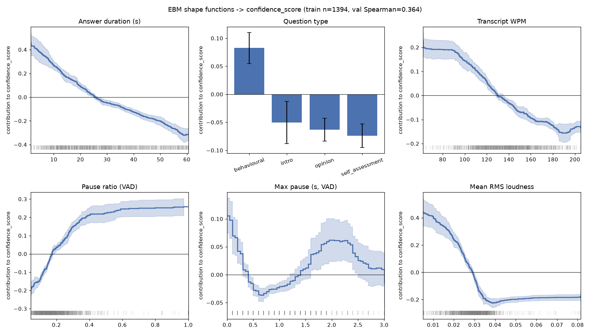
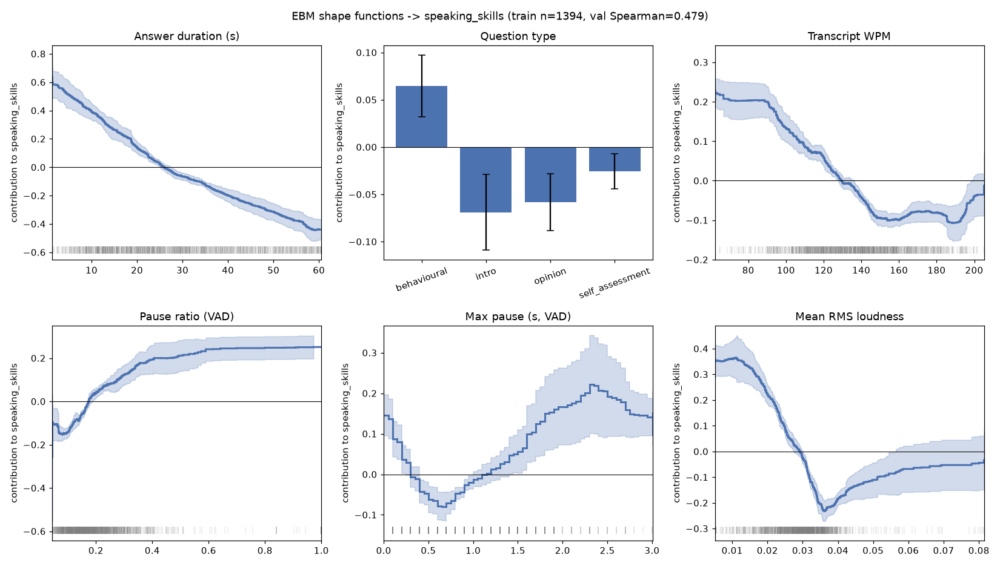
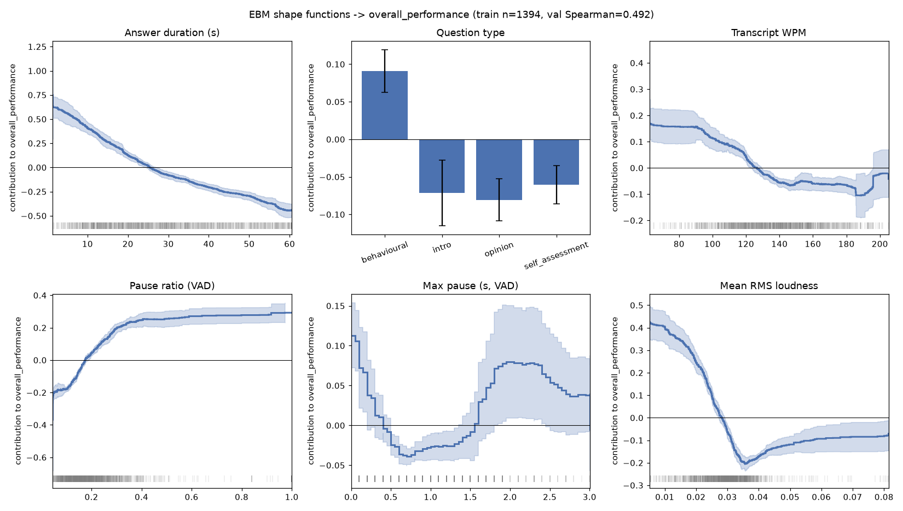

# Stage 0: Confound audit

Generated by `scripts/explainability/stage0_confound_audit.py` on the **train split only** (1394 clips, 231 participants). 2000 participant-cluster bootstrap resamples, seed 42. Classification threshold: 95% CI excluding 0 **and** |ρ| ≥ 0.1.

Measures (all Spearman-type): **raw** = between clips; **partial** = between clips controlling for duration, question type and video_quality; **between** = participant means; **within** = after subtracting each participant's mean; **within_partial** = within, additionally controlling for duration and question type. Delivery is judged on *within_partial* (on *within* for features that are themselves duration proxies, |ρ(feature, duration)| ≥ 0.9). CIs are not corrected for multiple comparisons, so treat borderline single-target results with care.

## 1. Headline confounds (target: overall_performance)

| Measure | raw | partial | between | within | within_partial | ICC (speaker share) |
|---|---|---|---|---|---|---|
| `duration_s` | -0.42 [-0.48, -0.35] | -0.00 [-0.07, +0.07] | -0.56 [-0.65, -0.46] | -0.12 [-0.18, -0.07] | +0.00 [-0.06, +0.06] | 0.66 |
| `transcript_word_count` | -0.47 [-0.52, -0.41] | -0.25 [-0.31, -0.19] | -0.64 [-0.71, -0.56] | -0.13 [-0.18, -0.08] | -0.10 [-0.17, -0.04] | 0.64 |
| `vad_mean_rms` | -0.38 [-0.44, -0.31] | -0.29 [-0.36, -0.22] | -0.52 [-0.61, -0.42] | -0.09 [-0.14, -0.03] | -0.10 [-0.15, -0.05] | 0.70 |
| `rms_energy_mean` | -0.30 [-0.37, -0.22] | -0.23 [-0.30, -0.15] | -0.42 [-0.52, -0.30] | -0.04 [-0.10, +0.01] | -0.05 [-0.10, -0.00] | 0.67 |
| `vad_pause_ratio` | +0.38 [+0.31, +0.43] | +0.28 [+0.23, +0.34] | +0.60 [+0.51, +0.68] | +0.13 [+0.07, +0.18] | +0.11 [+0.06, +0.16] | 0.58 |
| `new_transcript_speech_rate_wpm` | -0.24 [-0.30, -0.17] | -0.23 [-0.29, -0.16] | -0.36 [-0.47, -0.23] | -0.08 [-0.14, -0.03] | -0.07 [-0.13, -0.02] | 0.48 |
| `f0_hz_mean` | -0.14 [-0.23, -0.06] | -0.14 [-0.21, -0.07] | -0.21 [-0.34, -0.09] | -0.04 [-0.10, +0.01] | -0.07 [-0.13, -0.01] | 0.90 |
| `new_relative_pitch_std_semitones` | +0.04 [-0.05, +0.13] | +0.01 [-0.07, +0.09] | +0.06 [-0.08, +0.19] | +0.04 [-0.01, +0.09] | +0.02 [-0.02, +0.07] | 0.91 |
| `vad_maximum_pause_duration_seconds` | -0.07 [-0.14, -0.00] | +0.18 [+0.12, +0.23] | +0.03 [-0.11, +0.16] | -0.06 [-0.12, -0.01] | -0.01 [-0.07, +0.04] | 0.42 |

## 2. Does duration need its own category (Conciseness)?

| Target | raw | between | within |
|---|---|---|---|
| confidence_score | -0.35 [-0.42, -0.28] | -0.49 [-0.58, -0.38] | -0.09 [-0.14, -0.03] |
| speaking_skills | -0.38 [-0.44, -0.31] | -0.50 [-0.60, -0.40] | -0.14 [-0.19, -0.10] |
| overall_performance | -0.42 [-0.48, -0.35] | -0.56 [-0.65, -0.46] | -0.12 [-0.18, -0.07] |

**Decision: yes.** Longer answers score lower *within* the same participant too, so answer length is a delivery-level behaviour that raters penalise, not only a person-level confound. Make it an explicit **Conciseness** category (duration relative to the question-type median), and keep controlling for duration in every other category so they do not become 'you talked too long' in disguise. Note the between-participant effect is much larger than the within effect: part of it is still the person.

## 3. Measures that must never become absolute advice

A measure lands here if (a) its relation with the scores disappears within participants once duration and question type are controlled (*speaker/mic effect*: it ranks people, or just tracks answer length), or (b) at least half of its variance is the speaker (ICC ≥ 0.5) **and** it is an absolute level (loudness, Hz pitch, energy), so a percentile against other people mostly ranks voices and microphones. These may only be used **speaker-relative** (vs the person's own other answers), as a duration-normalised rate, or not at all.

| Feature | Class | ICC | Reason |
|---|---|---|---|
| `new_f0_mean_hz` | speaker/mic effect | 0.93 | no within-participant relation after duration/question-type control; absolute level, mostly a speaker property |
| `f0_hz_mean` | weak delivery | 0.90 | absolute level, mostly a speaker property |
| `f0_hz_variation` | no relation | 0.89 | absolute level, mostly a speaker property |
| `new_rms_dynamic_range_db_p95_p05` | speaker/mic effect | 0.88 | no within-participant relation after duration/question-type control; absolute level, mostly a speaker property |
| `new_f0_std_hz` | no relation | 0.87 | absolute level, mostly a speaker property |
| `f0_hz_median` | speaker/mic effect | 0.87 | no within-participant relation after duration/question-type control; absolute level, mostly a speaker property |
| `f0_hz_std` | no relation | 0.84 | absolute level, mostly a speaker property |
| `new_voiced_percentage_of_speech` | speaker/mic effect | 0.77 | no within-participant relation after duration/question-type control |
| `vad_mean_rms` | weak delivery | 0.70 | absolute level, mostly a speaker property |
| `new_third_2_voiced_percentage` | speaker/mic effect | 0.69 | no within-participant relation after duration/question-type control |
| `vad_median_rms` | delivery | 0.69 | absolute level, mostly a speaker property |
| `shimmer_local_proxy_db` | speaker/mic effect | 0.69 | no within-participant relation after duration/question-type control |
| `new_mean_rms` | speaker/mic effect | 0.68 | no within-participant relation after duration/question-type control; absolute level, mostly a speaker property |
| `new_rms_std` | speaker/mic effect | 0.68 | no within-participant relation after duration/question-type control; absolute level, mostly a speaker property |
| `new_third_1_voiced_percentage` | speaker/mic effect | 0.68 | no within-participant relation after duration/question-type control |
| `rms_energy_mean` | weak delivery | 0.67 | absolute level, mostly a speaker property |
| `rms_energy_median` | speaker/mic effect | 0.67 | no within-participant relation after duration/question-type control; absolute level, mostly a speaker property |
| `new_third_3_voiced_percentage` | speaker/mic effect | 0.66 | no within-participant relation after duration/question-type control |
| `new_third_1_mean_rms` | weak delivery | 0.65 | absolute level, mostly a speaker property |
| `rms_energy_std` | speaker/mic effect | 0.65 | no within-participant relation after duration/question-type control; absolute level, mostly a speaker property |
| `vad_rms_threshold` | no relation | 0.63 | absolute level, mostly a speaker property |
| `rms_energy_range` | speaker/mic effect | 0.59 | no within-participant relation after duration/question-type control; absolute level, mostly a speaker property |
| `rms_energy_max` | speaker/mic effect | 0.59 | no within-participant relation after duration/question-type control; absolute level, mostly a speaker property |
| `pause_count` | speaker/mic effect | 0.59 | no within-participant relation after duration/question-type control |
| `vad_internal_pause_duration_seconds` | speaker/mic effect | 0.57 | no within-participant relation after duration/question-type control |
| `new_pause_count` | speaker/mic effect | 0.57 | no within-participant relation after duration/question-type control |
| `vad_number_of_pauses` | speaker/mic effect | 0.57 | no within-participant relation after duration/question-type control |
| `new_third_3_mean_rms` | speaker/mic effect | 0.56 | no within-participant relation after duration/question-type control; absolute level, mostly a speaker property |
| `rms_energy_variation` | speaker/mic effect | 0.51 | no within-participant relation after duration/question-type control; absolute level, mostly a speaker property |
| `new_third_2_mean_rms` | speaker/mic effect | 0.51 | no within-participant relation after duration/question-type control; absolute level, mostly a speaker property |
| `new_pause_ratio` | speaker/mic effect | 0.49 | no within-participant relation after duration/question-type control |
| `vad_internal_pause_ratio` | speaker/mic effect | 0.49 | no within-participant relation after duration/question-type control |
| `vad_pauses_over_0_5_seconds` | speaker/mic effect | 0.46 | no within-participant relation after duration/question-type control |
| `new_pauses_over_0_5_seconds` | speaker/mic effect | 0.46 | no within-participant relation after duration/question-type control |
| `new_articulation_rate_wpm` | speaker/mic effect | 0.44 | no within-participant relation after duration/question-type control |
| `new_energy_slope_db_per_second` | speaker/mic effect | 0.44 | no within-participant relation after duration/question-type control |
| `pause_rate_per_minute` | speaker/mic effect | 0.44 | no within-participant relation after duration/question-type control |
| `pause_max_duration_seconds` | speaker/mic effect | 0.43 | no within-participant relation after duration/question-type control |
| `new_f0_min_hz` | speaker/mic effect | 0.42 | no within-participant relation after duration/question-type control |
| `new_longest_pause_seconds` | speaker/mic effect | 0.42 | no within-participant relation after duration/question-type control |
| `vad_maximum_pause_duration_seconds` | speaker/mic effect | 0.42 | no within-participant relation after duration/question-type control |
| `new_f0_max_hz` | speaker/mic effect | 0.41 | no within-participant relation after duration/question-type control |
| `new_f0_range_hz` | speaker/mic effect | 0.41 | no within-participant relation after duration/question-type control |
| `f0_hz_min` | speaker/mic effect | 0.41 | no within-participant relation after duration/question-type control |
| `f0_hz_range` | speaker/mic effect | 0.38 | no within-participant relation after duration/question-type control |
| `vad_mean_pause_duration_seconds` | speaker/mic effect | 0.35 | no within-participant relation after duration/question-type control |
| `new_mean_pause_duration_seconds` | speaker/mic effect | 0.35 | no within-participant relation after duration/question-type control |
| `new_pauses_over_1_second` | speaker/mic effect | 0.35 | no within-participant relation after duration/question-type control |
| `vad_pauses_over_1_second` | speaker/mic effect | 0.35 | no within-participant relation after duration/question-type control |
| `f0_hz_max` | speaker/mic effect | 0.23 | no within-participant relation after duration/question-type control |

## 3b. Signals that hold within participants (candidates for per-answer feedback)

*delivery* / *weak delivery* features: the same person scores differently on answers where this measure differs, after controlling for duration and question type. Values are the within-participant correlation used for classification (within_partial; within for duration proxies). Many rows are near-duplicates (the same quantity from the legacy, `new_` and `vad_` extractors).

| Feature | Class | ICC | conf | speak | overall |
|---|---|---|---|---|---|
| `duration_s` (dur. proxy) | delivery | 0.66 | -0.09 [-0.14, -0.03] | -0.14 [-0.19, -0.10] | -0.12 [-0.18, -0.07] |
| `new_non_speech_ratio_including_edges` | delivery | 0.58 | +0.12 [+0.05, +0.18] | +0.08 [+0.02, +0.13] | +0.11 [+0.06, +0.16] |
| `new_speech_duration_seconds` (dur. proxy) | delivery | 0.66 | -0.10 [-0.15, -0.05] | -0.15 [-0.20, -0.10] | -0.13 [-0.19, -0.08] |
| `silence_duration_seconds` (dur. proxy) | delivery | 0.66 | -0.06 [-0.12, -0.01] | -0.11 [-0.16, -0.07] | -0.10 [-0.15, -0.05] |
| `speech_duration_seconds` (dur. proxy) | delivery | 0.67 | -0.10 [-0.15, -0.04] | -0.15 [-0.20, -0.11] | -0.13 [-0.19, -0.08] |
| `speech_fraction` | delivery | 0.69 | -0.09 [-0.14, -0.03] | -0.06 [-0.12, -0.00] | -0.11 [-0.17, -0.05] |
| `speech_silence_ratio` | delivery | 0.69 | -0.09 [-0.14, -0.03] | -0.06 [-0.12, -0.00] | -0.11 [-0.17, -0.05] |
| `total_duration_seconds` (dur. proxy) | delivery | 0.66 | -0.09 [-0.14, -0.03] | -0.14 [-0.19, -0.10] | -0.12 [-0.18, -0.07] |
| `transcript_word_count` (dur. proxy) | delivery | 0.64 | -0.11 [-0.17, -0.06] | -0.14 [-0.19, -0.09] | -0.13 [-0.18, -0.08] |
| `vad_median_rms` | delivery | 0.69 | -0.11 [-0.17, -0.05] | -0.05 [-0.11, +0.01] | -0.11 [-0.17, -0.06] |
| `vad_pause_ratio` | delivery | 0.58 | +0.12 [+0.05, +0.18] | +0.08 [+0.02, +0.13] | +0.11 [+0.06, +0.16] |
| `vad_speech_duration_seconds` (dur. proxy) | delivery | 0.66 | -0.10 [-0.15, -0.05] | -0.15 [-0.20, -0.10] | -0.13 [-0.19, -0.08] |
| `f0_hz_mean` | weak delivery | 0.90 | -0.09 [-0.16, -0.02] | -0.02 [-0.08, +0.04] | -0.07 [-0.13, -0.01] |
| `new_non_speech_duration_seconds` | weak delivery | 0.62 | +0.05 [-0.01, +0.11] | +0.04 [-0.02, +0.10] | +0.06 [+0.00, +0.11] |
| `new_speech_rate_excluding_pauses_wpm` | weak delivery | 0.43 | -0.09 [-0.15, -0.03] | -0.05 [-0.10, +0.01] | -0.08 [-0.13, -0.02] |
| `new_third_1_mean_rms` | weak delivery | 0.65 | -0.07 [-0.12, -0.02] | -0.02 [-0.08, +0.03] | -0.05 [-0.10, +0.00] |
| `new_third_1_relative_pitch_mean_st` | weak delivery | 0.68 | -0.03 [-0.08, +0.02] | -0.06 [-0.10, -0.01] | +0.01 [-0.04, +0.05] |
| `new_transcript_speech_rate_wpm` | weak delivery | 0.48 | -0.10 [-0.15, -0.04] | -0.05 [-0.11, +0.01] | -0.07 [-0.13, -0.02] |
| `pause_mean_duration_seconds` | weak delivery | 0.37 | +0.01 [-0.04, +0.07] | -0.07 [-0.12, -0.01] | -0.00 [-0.06, +0.05] |
| `pause_median_duration_seconds` | weak delivery | 0.29 | -0.01 [-0.06, +0.05] | -0.09 [-0.14, -0.03] | -0.01 [-0.06, +0.04] |
| `rms_energy_mean` | weak delivery | 0.67 | -0.06 [-0.11, -0.00] | -0.02 [-0.08, +0.03] | -0.05 [-0.10, -0.00] |
| `vad_mean_rms` | weak delivery | 0.70 | -0.09 [-0.15, -0.04] | -0.06 [-0.12, +0.00] | -0.10 [-0.15, -0.05] |
| `vad_non_speech_duration_seconds` | weak delivery | 0.62 | +0.05 [-0.01, +0.11] | +0.04 [-0.02, +0.10] | +0.06 [+0.00, +0.11] |

## 4. Recording quality (`video_quality`)

255 Low vs 1139 High clips. 0 participants have clips of both qualities, so video_quality is essentially a participant/recording-setup property.

| Variable | median (Low) | median (High) | Mann-Whitney p |
|---|---|---|---|
| confidence_score | 0.050 | -0.038 | 0.112 |
| speaking_skills | 0.064 | -0.027 | 0.228 |
| overall_performance | 0.126 | 0.004 | 0.0671 |
| vad_mean_rms | 0.029 | 0.030 | 0.539 |
| duration_s | 24.451 | 28.605 | 0.00719 |

## 5. Question types

Labels: `Datasets/question_types.csv` (made by `scripts/explainability/make_question_types.py`). `within_mean_*` = mean of the participant-demeaned score, i.e. whether the *same* people score higher or lower on this type of question.

| Type | clips | median dur (s) | mean conf | mean speak | mean overall | within conf | within speak | within overall |
|---|---|---|---|---|---|---|---|---|
| intro | 274 | 23.1 | -0.020 | -0.004 | -0.014 | -0.008 | -0.000 | -0.008 |
| behavioural | 604 | 32.1 | +0.003 | -0.033 | -0.012 | +0.027 | -0.016 | +0.010 |
| self_assessment | 310 | 25.1 | -0.049 | +0.032 | -0.000 | -0.050 | +0.025 | -0.010 |
| opinion | 206 | 24.2 | +0.005 | +0.029 | +0.003 | +0.008 | +0.012 | -0.002 |

Kruskal-Wallis p (raw scores): conf 0.968, speak 0.917, overall 0.728. Within-participant: conf 0.792, speak 0.951, overall 0.944.

## 6. EBM shape functions

`ExplainableBoostingRegressor(interactions=0)` fitted on train with `duration_s`, `question_type`, `new_transcript_speech_rate_wpm`, `vad_pause_ratio`, `vad_maximum_pause_duration_seconds`, `vad_mean_rms`. Each panel shows how the predicted score moves with that variable, holding the others fixed (shaded band = bagging uncertainty, grey ticks = data density). Validation Spearman is only a sanity check; this model is for reading shapes, not for prediction.

| Target | val Spearman | Answer duration (s) | Question type | Transcript WPM | Pause ratio (VAD) | Max pause (s, VAD) | Mean RMS loudness |
|---|---|---|---|---|---|---|---|
| confidence_score | 0.364 | 0.165 | 0.071 | 0.082 | 0.099 | 0.031 | 0.161 |
| speaking_skills | 0.479 | 0.242 | 0.056 | 0.078 | 0.095 | 0.061 | 0.140 |
| overall_performance | 0.492 | 0.247 | 0.079 | 0.065 | 0.127 | 0.035 | 0.151 |

(Importances = mean absolute contribution, in target units.)

### confidence_score

### speaking_skills

### overall_performance

## 7. Feature classification

Counts: **speaker/mic effect**: 41, **no relation**: 14, **delivery**: 12, **weak delivery**: 11.

Per-target classes are listed as conf / speak / overall (D = delivery, S = speaker/mic, – = none). Correlations shown are for overall_performance. `within/raw` < 0.5 means most of the raw relation is between people even where a within effect exists.

| Feature | Class | per target | ρ(dur) | ICC | raw | partial | within | within_partial | within/raw |
|---|---|---|---|---|---|---|---|---|---|
| `duration_s` (dur. proxy) | delivery | d/D/D | +1.00 | 0.66 | -0.42 [-0.48, -0.35] | -0.00 [-0.07, +0.07] | -0.12 [-0.18, -0.07] | +0.00 [-0.06, +0.06] | 0.29 |
| `new_non_speech_ratio_including_edges` | delivery | D/d/D | -0.35 | 0.58 | +0.38 [+0.31, +0.43] | +0.28 [+0.23, +0.34] | +0.13 [+0.07, +0.18] | +0.11 [+0.06, +0.16] | 0.34 |
| `new_speech_duration_seconds` (dur. proxy) | delivery | d/D/D | +0.98 | 0.66 | -0.46 [-0.52, -0.39] | -0.28 [-0.33, -0.22] | -0.13 [-0.19, -0.08] | -0.11 [-0.16, -0.05] | 0.29 |
| `silence_duration_seconds` (dur. proxy) | delivery | d/D/d | +0.94 | 0.66 | -0.31 [-0.38, -0.24] | +0.28 [+0.21, +0.34] | -0.10 [-0.15, -0.05] | +0.07 [+0.01, +0.13] | 0.32 |
| `speech_duration_seconds` (dur. proxy) | delivery | d/D/D | +0.97 | 0.67 | -0.47 [-0.53, -0.41] | -0.31 [-0.37, -0.24] | -0.13 [-0.19, -0.08] | -0.10 [-0.17, -0.03] | 0.28 |
| `speech_fraction` | delivery | d/d/D | +0.31 | 0.69 | -0.39 [-0.44, -0.32] | -0.30 [-0.37, -0.24] | -0.12 [-0.17, -0.06] | -0.11 [-0.17, -0.05] | 0.30 |
| `speech_silence_ratio` | delivery | d/d/D | +0.31 | 0.69 | -0.39 [-0.44, -0.32] | -0.30 [-0.37, -0.24] | -0.10 [-0.17, -0.04] | -0.11 [-0.17, -0.05] | 0.27 |
| `total_duration_seconds` (dur. proxy) | delivery | d/D/D | +1.00 | 0.66 | -0.42 [-0.48, -0.35] | -0.00 [-0.07, +0.07] | -0.12 [-0.18, -0.07] | +0.00 [-0.06, +0.06] | 0.29 |
| `transcript_word_count` (dur. proxy) | delivery | D/D/D | +0.95 | 0.64 | -0.47 [-0.52, -0.41] | -0.25 [-0.31, -0.19] | -0.13 [-0.18, -0.08] | -0.10 [-0.17, -0.04] | 0.27 |
| `vad_median_rms` | delivery | D/S/D | +0.31 | 0.69 | -0.38 [-0.44, -0.31] | -0.29 [-0.36, -0.22] | -0.11 [-0.16, -0.05] | -0.11 [-0.17, -0.06] | 0.28 |
| `vad_pause_ratio` | delivery | D/d/D | -0.35 | 0.58 | +0.38 [+0.31, +0.43] | +0.28 [+0.23, +0.34] | +0.13 [+0.07, +0.18] | +0.11 [+0.06, +0.16] | 0.34 |
| `vad_speech_duration_seconds` (dur. proxy) | delivery | d/D/D | +0.98 | 0.66 | -0.46 [-0.52, -0.39] | -0.28 [-0.33, -0.22] | -0.13 [-0.19, -0.08] | -0.11 [-0.16, -0.05] | 0.29 |
| `f0_hz_mean` | weak delivery | d/S/d | +0.05 | 0.90 | -0.14 [-0.23, -0.06] | -0.14 [-0.21, -0.07] | -0.04 [-0.10, +0.01] | -0.07 [-0.13, -0.01] | 0.31 |
| `new_non_speech_duration_seconds` | weak delivery | S/S/d | +0.67 | 0.62 | -0.13 [-0.21, -0.05] | +0.24 [+0.18, +0.30] | -0.05 [-0.11, +0.00] | +0.06 [+0.00, +0.11] | 0.39 |
| `new_speech_rate_excluding_pauses_wpm` | weak delivery | d/S/d | +0.20 | 0.43 | -0.21 [-0.28, -0.14] | -0.15 [-0.22, -0.09] | -0.10 [-0.15, -0.04] | -0.08 [-0.13, -0.02] | 0.46 |
| `new_third_1_mean_rms` | weak delivery | d/S/S | +0.00 | 0.65 | -0.20 [-0.28, -0.12] | -0.23 [-0.29, -0.16] | -0.02 [-0.06, +0.04] | -0.05 [-0.10, +0.00] | 0.08 |
| `new_third_1_relative_pitch_mean_st` | weak delivery | –/d/– | -0.00 | 0.68 | -0.00 [-0.08, +0.08] | -0.00 [-0.08, +0.07] | +0.00 [-0.05, +0.06] | +0.01 [-0.04, +0.05] |  |
| `new_transcript_speech_rate_wpm` | weak delivery | d/S/d | +0.10 | 0.48 | -0.24 [-0.30, -0.17] | -0.23 [-0.29, -0.16] | -0.08 [-0.14, -0.03] | -0.07 [-0.13, -0.02] | 0.35 |
| `pause_mean_duration_seconds` | weak delivery | S/d/S | +0.12 | 0.37 | +0.05 [-0.02, +0.12] | +0.12 [+0.06, +0.18] | -0.01 [-0.07, +0.05] | -0.00 [-0.06, +0.05] | -0.16 |
| `pause_median_duration_seconds` | weak delivery | –/d/S | +0.04 | 0.29 | +0.03 [-0.03, +0.10] | +0.05 [-0.00, +0.11] | -0.01 [-0.07, +0.05] | -0.01 [-0.06, +0.04] |  |
| `rms_energy_mean` | weak delivery | d/S/d | +0.25 | 0.67 | -0.30 [-0.37, -0.22] | -0.23 [-0.30, -0.15] | -0.04 [-0.10, +0.01] | -0.05 [-0.10, -0.00] | 0.15 |
| `vad_mean_rms` | weak delivery | d/S/d | +0.31 | 0.70 | -0.38 [-0.44, -0.31] | -0.29 [-0.36, -0.22] | -0.09 [-0.14, -0.03] | -0.10 [-0.15, -0.05] | 0.24 |
| `vad_non_speech_duration_seconds` | weak delivery | S/S/d | +0.67 | 0.62 | -0.13 [-0.21, -0.05] | +0.24 [+0.18, +0.30] | -0.05 [-0.11, +0.00] | +0.06 [+0.00, +0.11] | 0.39 |
| `f0_hz_max` | speaker/mic effect | S/S/S | +0.26 | 0.23 | -0.18 [-0.23, -0.12] | -0.08 [-0.13, -0.02] | -0.04 [-0.09, +0.01] | -0.02 [-0.07, +0.02] | 0.22 |
| `f0_hz_median` | speaker/mic effect | S/–/S | +0.04 | 0.87 | -0.11 [-0.20, -0.03] | -0.11 [-0.19, -0.04] | -0.04 [-0.10, +0.01] | -0.04 [-0.09, +0.01] | 0.36 |
| `f0_hz_min` | speaker/mic effect | S/–/– | -0.32 | 0.41 | +0.06 [-0.02, +0.13] | -0.10 [-0.16, -0.03] | +0.02 [-0.04, +0.07] | -0.02 [-0.07, +0.04] | 0.34 |
| `f0_hz_range` | speaker/mic effect | –/S/S | +0.36 | 0.38 | -0.08 [-0.15, -0.01] | +0.08 [+0.02, +0.15] | -0.03 [-0.09, +0.03] | +0.02 [-0.04, +0.08] | 0.40 |
| `new_articulation_rate_wpm` | speaker/mic effect | S/S/S | -0.15 | 0.44 | -0.08 [-0.15, -0.00] | -0.15 [-0.22, -0.09] | +0.01 [-0.05, +0.07] | -0.01 [-0.07, +0.04] | -0.07 |
| `new_energy_slope_db_per_second` | speaker/mic effect | S/S/S | +0.47 | 0.44 | -0.11 [-0.18, -0.04] | +0.10 [+0.04, +0.15] | -0.04 [-0.09, +0.01] | +0.02 [-0.04, +0.07] | 0.37 |
| `new_f0_max_hz` | speaker/mic effect | S/S/S | +0.34 | 0.41 | -0.25 [-0.31, -0.19] | -0.14 [-0.20, -0.07] | -0.06 [-0.11, -0.01] | -0.02 [-0.08, +0.04] | 0.23 |
| `new_f0_mean_hz` | speaker/mic effect | S/S/S | +0.05 | 0.93 | -0.13 [-0.22, -0.05] | -0.13 [-0.21, -0.06] | -0.04 [-0.09, +0.02] | -0.04 [-0.09, +0.01] | 0.27 |
| `new_f0_min_hz` | speaker/mic effect | S/S/S | -0.44 | 0.42 | +0.13 [+0.05, +0.21] | -0.06 [-0.13, +0.01] | +0.02 [-0.04, +0.07] | -0.03 [-0.08, +0.03] | 0.12 |
| `new_f0_range_hz` | speaker/mic effect | S/S/S | +0.48 | 0.41 | -0.18 [-0.25, -0.10] | +0.03 [-0.04, +0.09] | -0.03 [-0.08, +0.03] | +0.02 [-0.03, +0.08] | 0.15 |
| `new_longest_pause_seconds` | speaker/mic effect | S/S/S | +0.48 | 0.42 | -0.07 [-0.14, -0.00] | +0.18 [+0.12, +0.23] | -0.06 [-0.12, -0.01] | -0.01 [-0.07, +0.04] | 0.90 |
| `new_mean_pause_duration_seconds` | speaker/mic effect | S/S/S | +0.24 | 0.35 | +0.00 [-0.06, +0.07] | +0.13 [+0.07, +0.19] | -0.06 [-0.12, +0.00] | -0.02 [-0.08, +0.04] |  |
| `new_mean_rms` | speaker/mic effect | S/S/S | +0.20 | 0.68 | -0.26 [-0.34, -0.19] | -0.21 [-0.28, -0.13] | -0.05 [-0.10, +0.01] | -0.04 [-0.09, +0.01] | 0.18 |
| `new_pause_count` | speaker/mic effect | S/S/S | +0.83 | 0.57 | -0.27 [-0.34, -0.20] | +0.14 [+0.09, +0.20] | -0.09 [-0.15, -0.04] | -0.01 [-0.06, +0.05] | 0.33 |
| `new_pause_ratio` | speaker/mic effect | S/S/S | +0.27 | 0.49 | +0.04 [-0.03, +0.11] | +0.18 [+0.13, +0.24] | -0.03 [-0.09, +0.03] | -0.01 [-0.06, +0.05] |  |
| `new_pauses_over_0_5_seconds` | speaker/mic effect | S/S/S | +0.53 | 0.46 | -0.09 [-0.16, -0.01] | +0.19 [+0.13, +0.24] | -0.06 [-0.11, -0.00] | -0.00 [-0.06, +0.05] | 0.65 |
| `new_pauses_over_1_second` | speaker/mic effect | S/S/S | +0.27 | 0.35 | +0.06 [+0.00, +0.13] | +0.21 [+0.15, +0.27] | -0.03 [-0.09, +0.03] | +0.02 [-0.04, +0.08] | -0.45 |
| `new_rms_dynamic_range_db_p95_p05` | speaker/mic effect | S/S/S | +0.05 | 0.88 | -0.16 [-0.24, -0.07] | -0.16 [-0.24, -0.08] | +0.01 [-0.05, +0.06] | +0.02 [-0.03, +0.07] | -0.03 |
| `new_rms_std` | speaker/mic effect | S/S/S | +0.21 | 0.68 | -0.28 [-0.35, -0.21] | -0.23 [-0.30, -0.16] | -0.02 [-0.08, +0.03] | -0.04 [-0.09, +0.01] | 0.08 |
| `new_third_1_voiced_percentage` | speaker/mic effect | S/S/S | -0.15 | 0.68 | -0.05 [-0.13, +0.04] | -0.12 [-0.19, -0.05] | -0.00 [-0.05, +0.05] | +0.00 [-0.05, +0.06] |  |
| `new_third_2_mean_rms` | speaker/mic effect | S/S/S | +0.19 | 0.51 | -0.22 [-0.29, -0.15] | -0.17 [-0.23, -0.10] | -0.04 [-0.10, +0.02] | -0.06 [-0.11, +0.00] | 0.19 |
| `new_third_2_voiced_percentage` | speaker/mic effect | S/S/S | -0.04 | 0.69 | -0.10 [-0.17, -0.02] | -0.12 [-0.19, -0.06] | -0.02 [-0.08, +0.04] | -0.00 [-0.06, +0.06] | 0.23 |
| `new_third_3_mean_rms` | speaker/mic effect | S/S/S | +0.40 | 0.56 | -0.27 [-0.34, -0.20] | -0.13 [-0.21, -0.06] | -0.05 [-0.11, +0.01] | -0.01 [-0.06, +0.04] | 0.19 |
| `new_third_3_voiced_percentage` | speaker/mic effect | S/S/S | +0.14 | 0.66 | -0.16 [-0.24, -0.08] | -0.12 [-0.19, -0.05] | -0.04 [-0.10, +0.02] | +0.01 [-0.05, +0.07] | 0.25 |
| `new_voiced_percentage_of_speech` | speaker/mic effect | S/S/S | +0.04 | 0.77 | -0.15 [-0.23, -0.07] | -0.15 [-0.22, -0.08] | -0.06 [-0.12, -0.00] | -0.02 [-0.08, +0.04] | 0.42 |
| `pause_count` | speaker/mic effect | S/S/S | +0.89 | 0.59 | -0.30 [-0.37, -0.23] | +0.19 [+0.12, +0.25] | -0.10 [-0.15, -0.05] | -0.02 [-0.08, +0.04] | 0.35 |
| `pause_max_duration_seconds` | speaker/mic effect | S/S/S | +0.41 | 0.43 | -0.03 [-0.10, +0.04] | +0.18 [+0.12, +0.24] | -0.03 [-0.09, +0.03] | +0.00 [-0.05, +0.06] |  |
| `pause_rate_per_minute` | speaker/mic effect | S/S/S | +0.16 | 0.44 | +0.10 [+0.03, +0.18] | +0.19 [+0.13, +0.26] | -0.02 [-0.07, +0.04] | +0.01 [-0.05, +0.06] | -0.15 |
| `rms_energy_max` | speaker/mic effect | S/S/S | +0.36 | 0.59 | -0.34 [-0.40, -0.27] | -0.23 [-0.29, -0.17] | -0.05 [-0.11, +0.01] | -0.03 [-0.08, +0.03] | 0.15 |
| `rms_energy_median` | speaker/mic effect | S/S/S | +0.24 | 0.67 | -0.26 [-0.34, -0.18] | -0.18 [-0.26, -0.11] | -0.06 [-0.11, +0.00] | -0.06 [-0.12, +0.00] | 0.22 |
| `rms_energy_range` | speaker/mic effect | S/S/S | +0.36 | 0.59 | -0.34 [-0.40, -0.27] | -0.23 [-0.29, -0.16] | -0.05 [-0.11, +0.01] | -0.03 [-0.08, +0.03] | 0.15 |
| `rms_energy_std` | speaker/mic effect | S/S/S | +0.19 | 0.65 | -0.27 [-0.34, -0.19] | -0.22 [-0.29, -0.15] | -0.02 [-0.08, +0.03] | -0.04 [-0.09, +0.01] | 0.09 |
| `rms_energy_variation` | speaker/mic effect | S/S/S | +0.05 | 0.51 | -0.13 [-0.21, -0.05] | -0.12 [-0.19, -0.06] | +0.01 [-0.05, +0.07] | -0.01 [-0.07, +0.04] | -0.07 |
| `shimmer_local_proxy_db` | speaker/mic effect | S/S/S | +0.16 | 0.69 | -0.19 [-0.27, -0.12] | -0.15 [-0.22, -0.08] | -0.02 [-0.07, +0.04] | -0.01 [-0.07, +0.04] | 0.09 |
| `vad_internal_pause_duration_seconds` | speaker/mic effect | S/S/S | +0.73 | 0.57 | -0.19 [-0.27, -0.12] | +0.19 [+0.14, +0.25] | -0.08 [-0.14, -0.03] | -0.01 [-0.06, +0.05] | 0.43 |
| `vad_internal_pause_ratio` | speaker/mic effect | S/S/S | +0.27 | 0.49 | +0.04 [-0.03, +0.11] | +0.18 [+0.13, +0.24] | -0.03 [-0.09, +0.03] | -0.01 [-0.06, +0.05] |  |
| `vad_maximum_pause_duration_seconds` | speaker/mic effect | S/S/S | +0.48 | 0.42 | -0.07 [-0.14, -0.00] | +0.18 [+0.12, +0.23] | -0.06 [-0.12, -0.01] | -0.01 [-0.07, +0.04] | 0.90 |
| `vad_mean_pause_duration_seconds` | speaker/mic effect | S/S/S | +0.24 | 0.35 | +0.00 [-0.06, +0.07] | +0.13 [+0.07, +0.19] | -0.06 [-0.12, +0.00] | -0.02 [-0.08, +0.04] |  |
| `vad_number_of_pauses` | speaker/mic effect | S/S/S | +0.83 | 0.57 | -0.27 [-0.34, -0.20] | +0.14 [+0.09, +0.20] | -0.09 [-0.15, -0.04] | -0.01 [-0.06, +0.05] | 0.33 |
| `vad_pauses_over_0_5_seconds` | speaker/mic effect | S/S/S | +0.53 | 0.46 | -0.09 [-0.16, -0.01] | +0.19 [+0.13, +0.24] | -0.06 [-0.11, -0.00] | -0.00 [-0.06, +0.05] | 0.65 |
| `vad_pauses_over_1_second` | speaker/mic effect | S/S/S | +0.27 | 0.35 | +0.06 [+0.00, +0.13] | +0.21 [+0.15, +0.27] | -0.03 [-0.09, +0.03] | +0.02 [-0.04, +0.08] | -0.45 |
| `f0_hz_std` | no relation | –/–/– | -0.07 | 0.84 | +0.01 [-0.08, +0.10] | -0.03 [-0.10, +0.05] | +0.03 [-0.03, +0.09] | +0.01 [-0.05, +0.07] |  |
| `f0_hz_variation` | no relation | –/–/– | -0.07 | 0.89 | +0.07 [-0.01, +0.16] | +0.05 [-0.02, +0.13] | +0.05 [-0.01, +0.11] | +0.03 [-0.02, +0.09] | 0.64 |
| `jitter_local_proxy_percent` | no relation | –/–/– | -0.09 | 0.85 | +0.05 [-0.04, +0.14] | +0.01 [-0.07, +0.09] | +0.00 [-0.06, +0.06] | -0.00 [-0.06, +0.06] | 0.01 |
| `new_f0_std_hz` | no relation | –/–/– | -0.08 | 0.87 | -0.01 [-0.10, +0.08] | -0.05 [-0.13, +0.03] | +0.02 [-0.03, +0.07] | +0.00 [-0.05, +0.06] |  |
| `new_final_contour_slope_semitones_per_second` | no relation | –/–/– | +0.07 | 0.16 | +0.02 [-0.05, +0.08] | +0.05 [-0.01, +0.11] | -0.01 [-0.07, +0.05] | -0.00 [-0.06, +0.06] |  |
| `new_median_pause_duration_seconds` | no relation | –/–/– | +0.15 | 0.30 | +0.00 [-0.07, +0.07] | +0.08 [+0.02, +0.14] | -0.04 [-0.10, +0.03] | -0.02 [-0.08, +0.04] |  |
| `new_pitch_slope_semitones_per_second` | no relation | –/–/– | +0.15 | 0.23 | -0.01 [-0.08, +0.06] | +0.06 [+0.00, +0.12] | -0.02 [-0.07, +0.04] | +0.01 [-0.04, +0.06] |  |
| `new_relative_pitch_mean_semitones` | no relation | –/–/– | +0.02 | 0.74 | -0.00 [-0.09, +0.08] | +0.01 [-0.07, +0.08] | +0.01 [-0.04, +0.07] | +0.01 [-0.03, +0.06] |  |
| `new_relative_pitch_std_semitones` | no relation | –/–/– | -0.08 | 0.91 | +0.04 [-0.05, +0.13] | +0.01 [-0.07, +0.09] | +0.04 [-0.01, +0.09] | +0.02 [-0.02, +0.07] |  |
| `new_third_2_relative_pitch_mean_st` | no relation | –/–/– | -0.00 | 0.68 | +0.01 [-0.07, +0.09] | +0.01 [-0.06, +0.08] | +0.01 [-0.04, +0.06] | +0.02 [-0.03, +0.06] |  |
| `new_third_3_relative_pitch_mean_st` | no relation | –/–/– | +0.05 | 0.65 | +0.00 [-0.07, +0.08] | +0.02 [-0.05, +0.10] | +0.00 [-0.05, +0.06] | +0.00 [-0.04, +0.05] |  |
| `rms_energy_min` | no relation | –/–/– | -0.14 | 0.45 | +0.07 [-0.00, +0.14] | +0.02 [-0.05, +0.09] | -0.00 [-0.06, +0.05] | -0.01 [-0.07, +0.04] | -0.04 |
| `vad_median_pause_duration_seconds` | no relation | –/–/– | +0.15 | 0.30 | +0.00 [-0.07, +0.07] | +0.08 [+0.02, +0.14] | -0.04 [-0.10, +0.03] | -0.02 [-0.08, +0.04] |  |
| `vad_rms_threshold` | no relation | –/–/– | +0.10 | 0.63 | -0.03 [-0.11, +0.04] | +0.01 [-0.06, +0.08] | -0.02 [-0.08, +0.03] | -0.04 [-0.09, +0.01] |  |

Full numbers for all targets and measures: `tables/correlations.csv`; one row per feature: `tables/classification.csv`.
