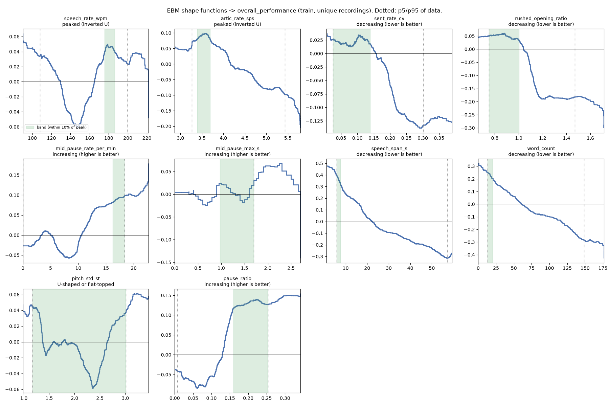

# Stage 3: Validation and calibration on RecruitView

Descriptor tables: **asr** (`results/explainability/stage4_asr/tables/segment_descriptors.csv`).

Generated by `scripts/explainability/stage3_validate_recruitview.py`. Per-signal checks and EBM bands use the **train split only** (1357 unique recordings; targets averaged over duplicate copies). The concept bottleneck and faithfulness checks use the **same 5x5 participant-grouped folds** over train+val as the WavLM baseline (`results/repeated_cv_v1/cv_splits.json`). Test is not used.

## 1. Headline

| Target | WavLM L7 + Ridge | delivery signals (no duration) | + duration | share of WavLM (no dur / with dur) | label agreement between duplicate copies |
|---|---|---|---|---|---|
| confidence_score | 0.499 | 0.408 | 0.460 | 82% / 92% | 0.55 |
| speaking_skills | 0.493 | 0.427 | 0.477 | 87% / 97% | 0.34 |
| overall_performance | 0.526 | 0.435 | 0.503 | 83% / 96% | 0.57 |

Pooled out-of-fold Spearman over all repeats (best of Ridge / EBM). The last column is the Spearman between the scores RecruitView raters gave to byte-identical copies of the same recording (Stage 1): a rough ceiling for any audio-only model.

Decisions: **revise** 35, **weak** 10, **drop** 6, **keep** 6 (details in §6).

### How much of a participant's answer-to-answer score variation is rater noise?

RecruitView contains byte-identical copies of the same recording, rated independently (Stage 1). Half the mean squared score difference between copies estimates the noise variance of a single rating. If it is close to the within-participant score variance, the within-participant tests below have almost no real signal to detect, whatever the delivery signals do.

| Target | duplicate pairs | rater-noise variance (95% CI) | within-participant variance | noise / within (95% CI) | noise / total |
|---|---|---|---|---|---|
| confidence_score | 54 | 0.88 [0.241, 1.846] | 0.83 | 105% [0.29, 2.22] | 76% |
| speaking_skills | 54 | 1.47 [0.466, 2.887] | 1.19 | 124% [0.39, 2.43] | 92% |
| overall_performance | 54 | 0.67 [0.26, 1.362] | 1.05 | 64% [0.25, 1.29] | 47% |

The duplicate pairs are few, so these are rough, but the message is clear: most of the variation between one person's answers in RecruitView is rating noise. RecruitView can show what raters reward **between people**; it has little power to show what changes a rating **from one answer to the next**. That per-answer validation has to come from MIT (Stage 7) and the in-house annotation (Stage 8).

## 2. Per-signal checks (train, unique recordings)

Same measures as Stage 0. **within_partial** = within participants, controlling for duration and question type (the delivery test). 95% participant-bootstrap CIs. Expected sign = the direction the feedback assumes (e.g. more mid-sentence pauses -> lower score).

| Signal | group | expected | within_partial conf | within_partial speak | within_partial overall | raw overall | between overall | ICC | decision |
|---|---|---|---|---|---|---|---|---|---|
| `terminal_slope_median_st_s` | assertiveness | - | +0.03 [-0.03, +0.08] | -0.03 [-0.09, +0.04] | +0.02 [-0.04, +0.08] | -0.03 [-0.09, +0.03] | -0.15 [-0.27, -0.02] | 0.14 | **revise** |
| `assertiveness_index` | assertiveness | - | +0.02 [-0.04, +0.08] | -0.03 [-0.10, +0.04] | +0.02 [-0.04, +0.08] | -0.00 [-0.06, +0.06] | -0.07 [-0.19, +0.06] | 0.13 | **drop** |
| `composure_index` | composure | - | -0.07 [-0.12, -0.01] | -0.05 [-0.11, +0.00] | -0.05 [-0.10, +0.01] | -0.05 [-0.09, -0.01] | -0.08 [-0.21, +0.05] | -0.18 | **weak** |
| `ser_arousal_mean` | composure | - | -0.06 [-0.12, -0.01] | -0.06 [-0.12, +0.00] | -0.05 [-0.10, +0.01] | -0.28 [-0.35, -0.20] | -0.41 [-0.51, -0.30] | 0.86 | **weak** |
| `ser_tension_run_s` | composure | - | -0.08 [-0.14, -0.01] | -0.08 [-0.13, -0.02] | -0.06 [-0.12, +0.00] | -0.15 [-0.20, -0.10] | -0.39 [-0.51, -0.27] | -0.05 | **weak** |
| `jitter_local` | composure | - | +0.03 [-0.04, +0.09] | +0.03 [-0.03, +0.10] | +0.02 [-0.04, +0.09] | +0.16 [+0.07, +0.24] | +0.25 [+0.12, +0.37] | 0.80 | **revise** |
| `ser_dominance_drop_sd` | composure | - | +0.00 [-0.06, +0.07] | -0.05 [-0.11, +0.01] | -0.03 [-0.09, +0.03] | -0.17 [-0.23, -0.11] | -0.37 [-0.47, -0.25] | 0.18 | **revise** |
| `ser_dominance_mean` | composure | + | -0.04 [-0.11, +0.01] | -0.06 [-0.12, +0.00] | -0.04 [-0.10, +0.02] | -0.28 [-0.35, -0.20] | -0.41 [-0.51, -0.30] | 0.86 | **revise** |
| `shimmer_local` | composure | - | +0.02 [-0.03, +0.08] | -0.01 [-0.07, +0.04] | +0.03 [-0.03, +0.09] | +0.18 [+0.09, +0.26] | +0.26 [+0.13, +0.37] | 0.85 | **revise** |
| `f0_median_st` | composure | - | -0.00 [-0.06, +0.06] | +0.01 [-0.06, +0.07] | -0.01 [-0.06, +0.05] | -0.01 [-0.06, +0.03] | -0.03 [-0.17, +0.10] | -0.16 | **drop** |
| `audio_duration_s` | conciseness | - | -0.08 [-0.14, -0.03] | -0.14 [-0.18, -0.09] | -0.12 [-0.17, -0.07] | -0.42 [-0.48, -0.35] | -0.56 [-0.65, -0.46] | 0.66 | **keep** |
| `conciseness_index` | conciseness | - | -0.11 [-0.17, -0.05] | -0.15 [-0.20, -0.10] | -0.14 [-0.19, -0.09] | -0.46 [-0.52, -0.39] | -0.61 [-0.69, -0.53] | 0.68 | **keep** |
| `n_sentences` | conciseness | - | -0.03 [-0.09, +0.03] | -0.11 [-0.16, -0.05] | -0.07 [-0.12, -0.01] | -0.39 [-0.45, -0.33] | -0.62 [-0.70, -0.53] | 0.45 | **keep** |
| `speech_span_s` | conciseness | - | -0.07 [-0.13, -0.02] | -0.13 [-0.18, -0.08] | -0.11 [-0.16, -0.06] | -0.42 [-0.48, -0.35] | -0.57 [-0.65, -0.47] | 0.64 | **keep** |
| `speech_time_s` | conciseness | - | -0.09 [-0.15, -0.04] | -0.15 [-0.19, -0.10] | -0.13 [-0.18, -0.07] | -0.46 [-0.52, -0.40] | -0.62 [-0.70, -0.53] | 0.66 | **keep** |
| `word_count` | conciseness | - | -0.10 [-0.15, -0.05] | -0.13 [-0.18, -0.08] | -0.12 [-0.17, -0.06] | -0.46 [-0.52, -0.40] | -0.64 [-0.71, -0.56] | 0.63 | **keep** |
| `category_conciseness` | conciseness | + | +0.06 [+0.01, +0.11] | +0.10 [+0.04, +0.15] | +0.05 [-0.00, +0.11] | +0.31 [+0.24, +0.38] | +0.48 [+0.37, +0.57] | 0.52 | **weak** |
| `f0_median_hz` | diagnostic | ? | -0.00 [-0.06, +0.05] | -0.01 [-0.06, +0.04] | -0.01 [-0.06, +0.04] | -0.14 [-0.23, -0.05] | -0.21 [-0.34, -0.08] | 0.97 | **revise** |
| `intensity_mean_db` | diagnostic | ? | -0.05 [-0.10, +0.01] | +0.01 [-0.05, +0.06] | -0.04 [-0.10, +0.01] | -0.19 [-0.27, -0.12] | -0.33 [-0.44, -0.21] | 0.61 | **revise** |
| `ser_valence_mean` | diagnostic | ? | -0.08 [-0.14, -0.03] | -0.06 [-0.12, -0.00] | -0.09 [-0.15, -0.03] | -0.21 [-0.28, -0.14] | -0.33 [-0.45, -0.21] | 0.43 | **revise** |
| `expressiveness_index` | expressiveness | + | -0.03 [-0.08, +0.02] | -0.04 [-0.10, +0.01] | -0.02 [-0.06, +0.03] | -0.09 [-0.17, -0.01] | -0.12 [-0.24, +0.01] | 0.72 | **revise** |
| `intensity_std_db` | expressiveness | + | +0.01 [-0.05, +0.07] | -0.04 [-0.09, +0.01] | +0.01 [-0.04, +0.06] | -0.12 [-0.21, -0.03] | -0.14 [-0.27, -0.01] | 0.86 | **revise** |
| `monotony_frac` | expressiveness | - | +0.02 [-0.04, +0.08] | +0.02 [-0.03, +0.08] | +0.01 [-0.04, +0.07] | +0.05 [-0.02, +0.12] | +0.11 [-0.02, +0.24] | 0.58 | **revise** |
| `pitch_range_st` | expressiveness | + | -0.03 [-0.08, +0.02] | -0.03 [-0.08, +0.03] | -0.01 [-0.06, +0.03] | -0.09 [-0.17, -0.02] | -0.12 [-0.25, +0.01] | 0.69 | **revise** |
| `pitch_std_st` | expressiveness | + | -0.04 [-0.10, +0.02] | -0.05 [-0.10, +0.01] | -0.03 [-0.08, +0.02] | -0.09 [-0.17, -0.01] | -0.12 [-0.25, +0.01] | 0.72 | **revise** |
| `flag_long_answer` | flag | - | -0.06 [-0.10, -0.00] | -0.06 [-0.11, -0.01] | -0.03 [-0.09, +0.02] | -0.17 [-0.23, -0.11] | -0.34 [-0.45, -0.22] | 0.15 | **weak** |
| `flag_tension_rise` | flag | - | -0.07 [-0.14, -0.01] | -0.06 [-0.12, -0.00] | -0.06 [-0.13, -0.00] | -0.14 [-0.19, -0.09] | -0.26 [-0.38, -0.14] | -0.04 | **weak** |
| `flag_trails_off` | flag | - | -0.10 [-0.17, -0.03] | -0.07 [-0.13, -0.01] | -0.10 [-0.15, -0.04] | -0.09 [-0.14, -0.04] | -0.10 [-0.23, +0.03] | -0.02 | **weak** |
| `flag_composure_drop` | flag | - | +0.02 [-0.04, +0.09] | +0.00 [-0.05, +0.06] | -0.01 [-0.07, +0.06] | -0.06 [-0.12, -0.01] | -0.17 [-0.30, -0.05] | -0.01 | **revise** |
| `flag_hesitation` | flag | - | +0.00 [-0.06, +0.07] | +0.04 [-0.02, +0.09] | +0.00 [-0.06, +0.07] | +0.11 [+0.05, +0.16] | +0.30 [+0.19, +0.41] | 0.16 | **revise** |
| `flag_monotone` | flag | - | +0.02 [-0.03, +0.06] | +0.01 [-0.03, +0.05] | +0.04 [-0.00, +0.09] | +0.05 [-0.01, +0.11] | +0.12 [-0.01, +0.23] | 0.43 | **revise** |
| `flag_rushed_opening` | flag | - | -0.00 [-0.06, +0.06] | -0.03 [-0.08, +0.03] | -0.02 [-0.09, +0.04] | -0.05 [-0.10, -0.00] | -0.08 [-0.20, +0.03] | 0.08 | **revise** |
| `flag_slow_start` | flag | - | -0.01 [-0.07, +0.05] | +0.01 [-0.04, +0.07] | +0.01 [-0.04, +0.07] | +0.05 [-0.01, +0.11] | +0.13 [+0.01, +0.26] | 0.26 | **revise** |
| `flag_too_fast` | flag | - | -0.03 [-0.10, +0.03] | -0.04 [-0.10, +0.03] | -0.03 [-0.10, +0.03] | -0.12 [-0.18, -0.06] | -0.28 [-0.38, -0.16] | 0.08 | **revise** |
| `flag_too_slow` | flag | - | +0.00 [-0.06, +0.06] | -0.01 [-0.07, +0.06] | -0.01 [-0.07, +0.05] | -0.08 [-0.13, -0.02] | -0.15 [-0.28, -0.03] | 0.07 | **revise** |
| `flag_uptalk` | flag | - | +0.01 [-0.05, +0.07] | -0.05 [-0.11, +0.01] | -0.01 [-0.07, +0.05] | -0.06 [-0.12, +0.00] | -0.15 [-0.27, -0.02] | 0.11 | **revise** |
| `artic_rate_sps` | pace | - | -0.06 [-0.11, -0.00] | -0.02 [-0.07, +0.04] | -0.01 [-0.06, +0.05] | -0.11 [-0.18, -0.05] | -0.20 [-0.33, -0.08] | 0.47 | **weak** |
| `pace_index` | pace | - | -0.07 [-0.12, -0.02] | -0.04 [-0.09, +0.01] | -0.02 [-0.07, +0.04] | -0.17 [-0.23, -0.10] | -0.31 [-0.43, -0.20] | 0.50 | **weak** |
| `speech_rate_wpm` | pace | - | -0.06 [-0.11, -0.01] | -0.03 [-0.08, +0.03] | -0.02 [-0.08, +0.03] | -0.11 [-0.18, -0.04] | -0.21 [-0.33, -0.08] | 0.45 | **weak** |
| `category_pace` | pace | + | +0.04 [-0.02, +0.09] | +0.01 [-0.05, +0.06] | +0.01 [-0.04, +0.07] | +0.13 [+0.07, +0.20] | +0.21 [+0.09, +0.34] | 0.28 | **revise** |
| `rushed_opening_ratio` | pace | - | +0.08 [+0.00, +0.16] | +0.06 [-0.01, +0.14] | +0.03 [-0.05, +0.11] | +0.01 [-0.06, +0.09] | +0.07 [-0.06, +0.20] | 0.13 | **revise** |
| `sent_rate_max_wpm` | pace | - | -0.04 [-0.09, +0.02] | -0.03 [-0.09, +0.03] | -0.02 [-0.08, +0.04] | -0.24 [-0.30, -0.17] | -0.46 [-0.56, -0.36] | 0.40 | **revise** |
| `sent_rate_mean_wpm` | pace | - | -0.05 [-0.10, +0.01] | -0.02 [-0.08, +0.04] | -0.02 [-0.08, +0.04] | -0.13 [-0.19, -0.06] | -0.26 [-0.38, -0.13] | 0.42 | **revise** |
| `rate_drift_ratio` | pace | ? | -0.03 [-0.10, +0.04] | -0.02 [-0.08, +0.05] | -0.05 [-0.12, +0.01] | -0.04 [-0.11, +0.02] | -0.05 [-0.18, +0.08] | 0.11 | **drop** |
| `sent_rate_cv` | pace | - | -0.01 [-0.09, +0.06] | -0.05 [-0.12, +0.02] | -0.00 [-0.08, +0.07] | -0.03 [-0.09, +0.04] | -0.12 [-0.24, +0.02] | 0.02 | **drop** |
| `between_pause_time_ratio` | pausing | + | +0.02 [-0.03, +0.08] | -0.03 [-0.08, +0.03] | +0.02 [-0.04, +0.07] | -0.12 [-0.19, -0.06] | -0.07 [-0.19, +0.07] | 0.29 | **revise** |
| `long_mid_pause_rate_per_min` | pausing | - | +0.02 [-0.04, +0.08] | +0.03 [-0.02, +0.09] | +0.02 [-0.04, +0.08] | +0.08 [+0.02, +0.15] | +0.25 [+0.12, +0.37] | 0.28 | **revise** |
| `mid_pause_max_s` | pausing | - | +0.01 [-0.05, +0.07] | +0.01 [-0.04, +0.06] | -0.02 [-0.07, +0.04] | -0.04 [-0.12, +0.03] | +0.05 [-0.09, +0.19] | 0.41 | **revise** |
| `mid_pause_rate_per_min` | pausing | - | -0.02 [-0.08, +0.04] | -0.03 [-0.08, +0.03] | -0.02 [-0.07, +0.04] | +0.07 [+0.00, +0.14] | +0.23 [+0.10, +0.36] | 0.39 | **revise** |
| `mid_pause_time_ratio` | pausing | - | -0.00 [-0.06, +0.06] | -0.01 [-0.07, +0.04] | -0.01 [-0.07, +0.04] | +0.07 [-0.00, +0.14] | +0.26 [+0.12, +0.39] | 0.43 | **revise** |
| `pause_ratio` | pausing | + | +0.02 [-0.03, +0.08] | -0.01 [-0.07, +0.05] | +0.01 [-0.04, +0.07] | +0.09 [+0.02, +0.17] | +0.24 [+0.11, +0.36] | 0.53 | **revise** |
| `pausing_fluency_index` | pausing | ? | +0.01 [-0.05, +0.07] | +0.01 [-0.04, +0.07] | -0.02 [-0.07, +0.04] | +0.16 [+0.09, +0.23] | +0.34 [+0.21, +0.45] | 0.44 | **revise** |
| `filled_pause_rate_per_min` | pausing | - | +0.01 [-0.05, +0.06] | +0.01 [-0.05, +0.06] | +0.00 [-0.06, +0.06] | +0.01 [-0.06, +0.07] | +0.04 [-0.09, +0.18] | 0.39 | **drop** |
| `response_latency_s` | pausing | - | +0.01 [-0.05, +0.07] | +0.02 [-0.04, +0.07] | +0.03 [-0.03, +0.09] | -0.02 [-0.10, +0.05] | -0.03 [-0.16, +0.10] | 0.45 | **drop** |
| `asr_prob_mean` | projection | + | -0.06 [-0.12, -0.00] | -0.10 [-0.15, -0.04] | -0.04 [-0.10, +0.02] | -0.21 [-0.27, -0.14] | -0.41 [-0.53, -0.29] | 0.39 | **revise** |
| `end_drop_median_db` | projection | + | +0.05 [-0.01, +0.11] | +0.05 [-0.01, +0.09] | +0.05 [-0.00, +0.11] | +0.06 [-0.00, +0.13] | +0.10 [-0.03, +0.23] | 0.20 | **revise** |
| `projection_index` | projection | - | -0.04 [-0.10, +0.02] | -0.04 [-0.09, +0.01] | -0.05 [-0.10, +0.00] | -0.09 [-0.16, -0.03] | -0.16 [-0.29, -0.03] | 0.19 | **revise** |

For conciseness signals (duration proxies) the within column is *within* (not partial: controlling duration for duration is meaningless).

## 3. Optimal bands (EBM shape functions, overall_performance)

`ExplainableBoostingRegressor(interactions=0)` on train with all delivery signals + duration + question type. Band = values where the shape is within 10% of its range below the peak, inside the observed p5-p95. Band-edge CIs from 20 participant-bootstrap refits.

A band counts as **identified** only if both edges' 95% CIs span < 25% of the observed p5-p95 range **and** the shape has an interior optimum (peaked or U-shaped). For monotonic shapes the 'band' is just the end of the observed range, so there is no optimum to calibrate; Stage 2 then keeps its provisional percentile band and uses the shape only as the direction.

| Signal | shape | band | lower edge 95% CI | upper edge 95% CI | observed p5-p95 | identified? | EBM importance |
|---|---|---|---|---|---|---|---|
| `speech_rate_wpm` | peaked (inverted U) | 176 - 186 | [108.018, 194.744] | [116.981, 199.037] | 108 - 199 | no | 0.034 |
| `artic_rate_sps` | peaked (inverted U) | 3.39 - 3.69 | [3.271, 4.616] | [3.625, 5.027] | 3.27 - 5.43 | no | 0.056 |
| `sent_rate_cv` | decreasing (lower is better) | 0.0255 - 0.139 | [0.026, 0.196] | [0.065, 0.285] | 0.0253 - 0.302 | no | 0.043 |
| `rushed_opening_ratio` | decreasing (lower is better) | 0.751 - 1 | [0.751, 1.047] | [0.857, 1.466] | 0.75 - 1.47 | no | 0.066 |
| `mid_pause_rate_per_min` | increasing (higher is better) | 16.2 - 18.3 | [0.894, 18.176] | [2.904, 18.334] | 0 - 18.3 | no | 0.035 |
| `mid_pause_max_s` | increasing (higher is better) | 0.975 - 1.7 | [0.075, 1.688] | [0.734, 1.7] | 0 - 1.7 | no | 0.012 |
| `speech_span_s` | decreasing (lower is better) | 5.8 - 7.48 | [5.8, 5.925] | [6.775, 17.61] | 5.79 - 57.2 | no | 0.182 |
| `word_count` | decreasing (lower is better) | 13 - 20 | [13.0, 15.0] | [15.475, 35.675] | 13 - 148 | no | 0.129 |
| `pitch_std_st` | U-shaped or flat-topped | 1.17 - 3.01 | [1.174, 2.816] | [1.342, 3.009] | 1.17 - 3.01 | no | 0.019 |
| `pause_ratio` | increasing (higher is better) | 0.16 - 0.253 | [0.016, 0.225] | [0.185, 0.253] | 0.00674 - 0.254 | no | 0.074 |

## 4. Concept bottleneck (same folds as WavLM)

| Model | with duration | target | repeats | pooled Spearman | pooled Pearson | share of WavLM |
|---|---|---|---|---|---|---|
| WavLM L7 + Ridge |  | confidence_score | 5 | 0.499 | 0.453 | 100% |
| signals-EBM | False | confidence_score | 5 | 0.408 | 0.376 | 82% |
| signals-EBM | True | confidence_score | 5 | 0.460 | 0.418 | 92% |
| signals-Ridge | False | confidence_score | 5 | 0.358 | 0.326 | 72% |
| signals-Ridge | True | confidence_score | 5 | 0.442 | 0.404 | 89% |
| WavLM L7 + Ridge |  | overall_performance | 5 | 0.526 | 0.446 | 100% |
| signals-EBM | False | overall_performance | 5 | 0.435 | 0.383 | 83% |
| signals-EBM | True | overall_performance | 5 | 0.503 | 0.439 | 96% |
| signals-Ridge | False | overall_performance | 5 | 0.389 | 0.325 | 74% |
| signals-Ridge | True | overall_performance | 5 | 0.494 | 0.422 | 94% |
| WavLM L7 + Ridge |  | speaking_skills | 5 | 0.493 | 0.435 | 100% |
| signals-EBM | False | speaking_skills | 5 | 0.427 | 0.376 | 87% |
| signals-EBM | True | speaking_skills | 5 | 0.477 | 0.417 | 97% |
| signals-Ridge | False | speaking_skills | 5 | 0.360 | 0.308 | 73% |
| signals-Ridge | True | speaking_skills | 5 | 0.452 | 0.390 | 92% |

## 5. Faithfulness: how much of WavLM's prediction do the signals explain?

Target = WavLM L7 + Ridge out-of-fold prediction (mean over 5 repeats) for each train+val clip. R² from a participant-grouped 5-fold Ridge (cross-validated), and in-sample for reference.

| Target | explaining variables | # vars | R² (CV) | R² (in-sample) |
|---|---|---|---|---|
| confidence_score | duration only | 1 | 0.276 | 0.289 |
| confidence_score | duration + loudness (confounds) | 2 | 0.316 | 0.329 |
| confidence_score | delivery signals (no duration) | 23 | 0.466 | 0.517 |
| confidence_score | delivery signals + duration | 28 | 0.652 | 0.695 |
| confidence_score | delivery signals + duration + loudness | 29 | 0.665 | 0.707 |
| speaking_skills | duration only | 1 | 0.339 | 0.349 |
| speaking_skills | duration + loudness (confounds) | 2 | 0.370 | 0.382 |
| speaking_skills | delivery signals (no duration) | 23 | 0.447 | 0.498 |
| speaking_skills | delivery signals + duration | 28 | 0.652 | 0.696 |
| speaking_skills | delivery signals + duration + loudness | 29 | 0.660 | 0.705 |
| overall_performance | duration only | 1 | 0.384 | 0.393 |
| overall_performance | duration + loudness (confounds) | 2 | 0.416 | 0.424 |
| overall_performance | delivery signals (no duration) | 23 | 0.416 | 0.474 |
| overall_performance | delivery signals + duration | 28 | 0.659 | 0.702 |
| overall_performance | delivery signals + duration + loudness | 29 | 0.670 | 0.711 |

## 6. Grouped attribution (which category moves the prediction)

Mean absolute per-clip contribution of each category to the bottleneck model's held-out prediction (repeat 0; Ridge = exact linear attribution on standardised inputs, EBM = additive term scores), in target units.

| model | with duration | target | assertiveness | composure | expressiveness | pace | pausing | projection | question type | conciseness |
|---|---|---|---|---|---|---|---|---|---|---|
| EBM | False | confidence_score | 0.034 | 0.122 | 0.108 | 0.211 | 0.095 | 0.019 | 0.047 | nan |
| EBM | False | overall_performance | 0.033 | 0.107 | 0.090 | 0.272 | 0.108 | 0.027 | 0.051 | nan |
| EBM | False | speaking_skills | 0.036 | 0.099 | 0.111 | 0.261 | 0.134 | 0.035 | 0.040 | nan |
| EBM | True | confidence_score | 0.024 | 0.110 | 0.080 | 0.106 | 0.106 | 0.021 | 0.068 | 0.251 |
| EBM | True | overall_performance | 0.019 | 0.091 | 0.055 | 0.106 | 0.110 | 0.029 | 0.075 | 0.331 |
| EBM | True | speaking_skills | 0.022 | 0.084 | 0.078 | 0.120 | 0.127 | 0.033 | 0.055 | 0.288 |
| Ridge | False | confidence_score | 0.038 | 0.198 | 0.094 | 0.180 | 0.093 | 0.028 | 0.041 | nan |
| Ridge | False | overall_performance | 0.036 | 0.198 | 0.084 | 0.221 | 0.109 | 0.048 | 0.045 | nan |
| Ridge | False | speaking_skills | 0.050 | 0.184 | 0.096 | 0.209 | 0.099 | 0.049 | 0.028 | nan |
| Ridge | True | confidence_score | 0.026 | 0.137 | 0.055 | 0.082 | 0.079 | 0.023 | 0.066 | 0.297 |
| Ridge | True | overall_performance | 0.026 | 0.127 | 0.034 | 0.060 | 0.081 | 0.039 | 0.071 | 0.382 |
| Ridge | True | speaking_skills | 0.036 | 0.120 | 0.052 | 0.063 | 0.093 | 0.043 | 0.057 | 0.359 |

Per-clip values: `tables/category_contributions.csv`.

## 7. Decisions

| Signal | group | decision | reason | EBM shape |
|---|---|---|---|---|
| `terminal_slope_median_st_s` | assertiveness | **revise** | relation only between participants (measures the person) |  |
| `assertiveness_index` | assertiveness | **drop** | no relation with any target |  |
| `ser_arousal_mean` | composure | **weak** | expected direction within participants but |rho| < 0.10 (conf) |  |
| `ser_tension_run_s` | composure | **weak** | expected direction within participants but |rho| < 0.10 (conf, speak) |  |
| `composure_index` | composure | **weak** | expected direction within participants but |rho| < 0.10 (conf) |  |
| `jitter_local` | composure | **revise** | relation only between participants (measures the person) |  |
| `shimmer_local` | composure | **revise** | relation only between participants (measures the person) |  |
| `ser_dominance_mean` | composure | **revise** | relation only between participants (measures the person) |  |
| `ser_dominance_drop_sd` | composure | **revise** | relation only between participants (measures the person) |  |
| `f0_median_st` | composure | **drop** | no relation with any target |  |
| `audio_duration_s` | conciseness | **keep** | expected direction within participants, |rho| >= 0.10 (speak, overall) |  |
| `speech_span_s` | conciseness | **keep** | expected direction within participants, |rho| >= 0.10 (speak, overall) | decreasing (lower is better) |
| `speech_time_s` | conciseness | **keep** | expected direction within participants, |rho| >= 0.10 (speak, overall) |  |
| `word_count` | conciseness | **keep** | expected direction within participants, |rho| >= 0.10 (conf, speak, overall) | decreasing (lower is better) |
| `n_sentences` | conciseness | **keep** | expected direction within participants, |rho| >= 0.10 (speak) |  |
| `conciseness_index` | conciseness | **keep** | expected direction within participants, |rho| >= 0.10 (conf, speak, overall) |  |
| `category_conciseness` | conciseness | **weak** | expected direction within participants but |rho| < 0.10 (conf, speak) |  |
| `intensity_mean_db` | diagnostic | **revise** | no direction assumed; speaker/mic effect |  |
| `f0_median_hz` | diagnostic | **revise** | no direction assumed; speaker/mic effect |  |
| `ser_valence_mean` | diagnostic | **revise** | no direction assumed; within effect - on conf, speak, overall |  |
| `pitch_std_st` | expressiveness | **revise** | relation only between participants (measures the person) | U-shaped or flat-topped |
| `pitch_range_st` | expressiveness | **revise** | relation only between participants (measures the person) |  |
| `intensity_std_db` | expressiveness | **revise** | relation only between participants (measures the person) |  |
| `monotony_frac` | expressiveness | **revise** | relation only between participants (measures the person) |  |
| `expressiveness_index` | expressiveness | **revise** | relation only between participants (measures the person) |  |
| `flag_long_answer` | flag | **weak** | expected direction within participants but |rho| < 0.10 (conf, speak) |  |
| `flag_tension_rise` | flag | **weak** | expected direction within participants but |rho| < 0.10 (conf, speak, overall) |  |
| `flag_trails_off` | flag | **weak** | expected direction within participants but |rho| < 0.10 (conf, speak, overall) |  |
| `flag_composure_drop` | flag | **revise** | relation only between participants (measures the person) |  |
| `flag_hesitation` | flag | **revise** | relation only between participants (measures the person) |  |
| `flag_monotone` | flag | **revise** | relation only between participants (measures the person) |  |
| `flag_rushed_opening` | flag | **revise** | relation only between participants (measures the person) |  |
| `flag_slow_start` | flag | **revise** | relation only between participants (measures the person) |  |
| `flag_too_fast` | flag | **revise** | relation only between participants (measures the person) |  |
| `flag_too_slow` | flag | **revise** | relation only between participants (measures the person) |  |
| `flag_uptalk` | flag | **revise** | relation only between participants (measures the person) |  |
| `speech_rate_wpm` | pace | **weak** | expected direction within participants but |rho| < 0.10 (conf) | peaked (inverted U) |
| `artic_rate_sps` | pace | **weak** | expected direction within participants but |rho| < 0.10 (conf) | peaked (inverted U) |
| `pace_index` | pace | **weak** | expected direction within participants but |rho| < 0.10 (conf) |  |
| `sent_rate_mean_wpm` | pace | **revise** | relation only between participants (measures the person) |  |
| `sent_rate_max_wpm` | pace | **revise** | relation only between participants (measures the person) |  |
| `rushed_opening_ratio` | pace | **revise** | significant in the OPPOSITE direction within participants (conf) | decreasing (lower is better) |
| `category_pace` | pace | **revise** | relation only between participants (measures the person) |  |
| `sent_rate_cv` | pace | **drop** | no relation with any target | decreasing (lower is better) |
| `rate_drift_ratio` | pace | **drop** | no direction assumed; no relation |  |
| `pause_ratio` | pausing | **revise** | relation only between participants (measures the person) | increasing (higher is better) |
| `mid_pause_rate_per_min` | pausing | **revise** | relation only between participants (measures the person) | increasing (higher is better) |
| `long_mid_pause_rate_per_min` | pausing | **revise** | relation only between participants (measures the person) |  |
| `mid_pause_max_s` | pausing | **revise** | relation only between participants (measures the person) | increasing (higher is better) |
| `mid_pause_time_ratio` | pausing | **revise** | relation only between participants (measures the person) |  |
| `between_pause_time_ratio` | pausing | **revise** | relation only between participants (measures the person) |  |
| `pausing_fluency_index` | pausing | **revise** | no direction assumed; speaker/mic effect |  |
| `response_latency_s` | pausing | **drop** | no relation with any target |  |
| `filled_pause_rate_per_min` | pausing | **drop** | no relation with any target |  |
| `end_drop_median_db` | projection | **revise** | relation only between participants (measures the person) |  |
| `asr_prob_mean` | projection | **revise** | significant in the OPPOSITE direction within participants (conf, speak) |  |
| `projection_index` | projection | **revise** | relation only between participants (measures the person) |  |
